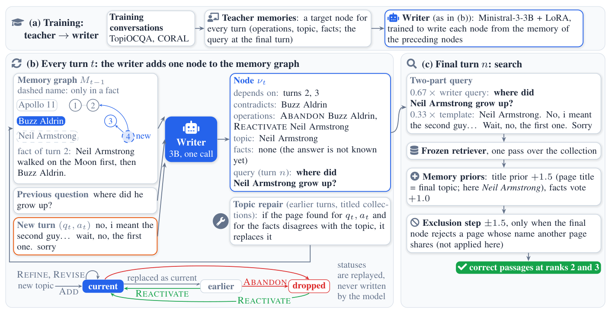
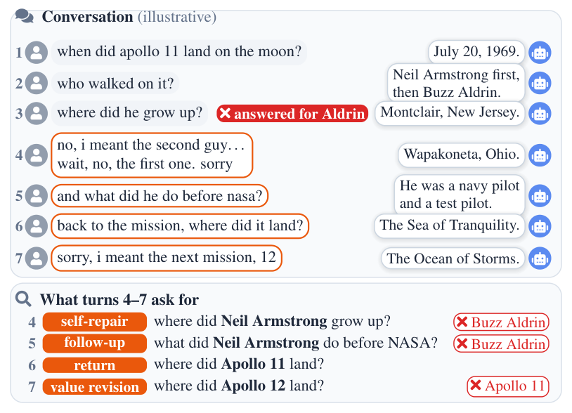

<p align="center">
  <picture>
    <source media="(prefers-color-scheme: dark)" srcset="assets/logo-dark.svg">
    
  </picture>
</p>

<h3 align="center">MemRevise: A Revisable Memory for Conversational Search</h3>

<p align="center">
  
  <a href="https://huggingface.co/datasets/mohammed933/ConvRevise"></a>
  <a href="https://huggingface.co/mohammed933/MemRevise-models"></a>
  
  
</p>

<p align="center">
  <a href="#overview">Overview</a> ·
  <a href="#the-convrevise-benchmark">Benchmark</a> ·
  <a href="#results">Results</a> ·
  <a href="#installation">Installation</a> ·
  <a href="#quick-start">Quick start</a> ·
  <a href="#competitors">Competitors</a> ·
  <a href="#citation">Citation</a>
</p>

**TL;DR.** In conversational search, users correct misunderstandings, revise their requests and return to earlier topics, so part of the history no longer reflects what they want. We introduce **ConvRevise**, a benchmark that isolates such turns, and **MemRevise**, a memory of the conversation that a 3B writer revises one turn at a time, so the search query always targets the topic the user means now. With a frozen retriever, MemRevise reaches a mean MRR@10 of 0.701, against 0.589 for the best competitor.

## Overview

<p align="center">
  
</p>

A 3B writer, distilled from teacher-written memories, adds one node per turn to a memory graph (topic, facts and operations); at the final turn its query is combined with evidence from the memory and searched with a frozen Reason-ModernColBERT retriever.

| Operation | Meaning | Status of the topic |
|---|---|---|
| `ADD` | introduces a new topic | becomes current; the previous one becomes earlier |
| `REFINE` | continues the current topic: the turn asks more about the topic already being discussed | stays current |
| `REVISE` | changes an established value, e.g. *the War of 1812* → *the one in 1863* | becomes current |
| `ABANDON` | drops a topic, e.g. after *"no, not that one"* | dropped, its facts kept |
| `REACTIVATE` | restores an earlier topic when the user returns to it | current again |

## The ConvRevise benchmark

<p align="center">
  
</p>

Each question is the last turn of a conversation in which the user corrects, revises or returns to a topic; a system must retrieve the passages for the topic the user means now. The benchmark and its passage collections are on [Hugging Face](https://huggingface.co/datasets/mohammed933/ConvRevise).

| Tier | The question | Test |
|---|---|--:|
| Return-1 | resumes the topic discussed just before the current one | 1,233 |
| Return-2+ | returns to a topic at least two topics earlier | 815 |
| Correction | rejects one or more topics and names the intended one | 1,239 |
| Follow-up | is a short question that depends on a preceding correction | 300 |
| Self-repair | corrects and re-corrects within the same turn | 608 |
| Value revision | changes a value in the topic's name | 234 |

## Results

MRR@10 on the test sets with the frozen retriever (Table 2 of the paper); MemRevise is the mean of three training seeds.

| Method | Size | TopiOCQA | CORAL | OR-QuAC | Mean |
|---|:-:|:-:|:-:|:-:|:-:|
| Original Query | – | 0.074 | 0.360 | 0.263 | 0.232 |
| T5QR | 0.2B | 0.243 | 0.460 | 0.353 | 0.352 |
| T5QR-FT | 0.2B | 0.342 | 0.469 | 0.302 | 0.371 |
| ConvGQR† | 0.2B | 0.288 | 0.404 | 0.470 | 0.387 |
| ConvSearch-R1 | 3B | 0.591 | 0.546 | 0.572 | 0.570 |
| ConvSearch-R1-FT | 3B | 0.611 | 0.570 | 0.588 | 0.589 |
| LLM-Rewrite | 32B | 0.499 | 0.609 | 0.581 | 0.563 |
| CHIQ-AD | 32B | 0.436 | 0.617 | 0.594 | 0.549 |
| CMT-RAG‡ | 32B | 0.283 | 0.507 | 0.440 | 0.410 |
| ChatRetriever | 7B | 0.448 | 0.433 | 0.468 | 0.450 |
| ChatRetriever-FT | 7B | 0.620 | 0.524 | 0.548 | 0.564 |
| **MemRevise** (mean of 3 seeds) | 3B | **0.686** | **0.634** | **0.783** | **0.701** |
| MemRevise, released writer (seed 1) | 3B | 0.689 | 0.633 | 0.788 | 0.703 |

-FT: continued on our training data; †: trained on our data, no released model; ‡: our re-implementation. ChatRetriever rows use their own retriever.

## Installation

```bash
git clone https://github.com/DataScienceUIBK/MemRevise && cd MemRevise
python -m venv .venv-writer      # the writer, and the LLM competitors
.venv-writer/bin/pip install torch==2.11.0 transformers==5.11.0 peft==0.19.1 accelerate==1.13.0 huggingface_hub==1.18.0 vllm==0.22.1
python -m venv .venv-retriever   # retrieval, evaluation, and the T5, ConvGQR and ChatRetriever competitors
.venv-retriever/bin/pip install torch==2.10.0 transformers==4.51.0 huggingface_hub==0.36.2 safetensors==0.7.0 numpy \
                                peft==0.18.1 sentencepiece tiktoken einops transformers_stream_generator
export MEMREVISE_RETRIEVER_PYTHON=$PWD/.venv-retriever/bin/python
bash scripts/download.sh         # the collections -> corpus/, the writer and its base model -> models/ (about 7.5 GB)
```

## Quick start

```bash
R=.venv-retriever/bin/python; W=.venv-writer/bin/python
for C in topiocqa coral orquac; do $R -m memrevise.encode_corpus --corpus $C; done     # once -> encoded/
for S in test_topiocqa test_coral test_orquac; do
  $W -m memrevise.write_memory --set $S      # memory and final query -> outputs/writer/$S/
  $R -m memrevise.search --set $S            # rankings
done
$R -m memrevise.evaluate --sets test_topiocqa test_coral test_orquac
```

`memrevise.evaluate` reports MRR@10, NDCG@3, Recall@10/100 and the stale-win rate per set and tier. `--shard i/n` splits any command over n GPUs. A small first run: `--set dev_orquac_value_revisions` (84 questions). Training the writer: `.venv-writer/bin/torchrun --nproc_per_node=4 -m memrevise.train`.

## Competitors

Each competitor writes its queries, `competitors.score_queries` ranks them with the frozen retriever, and `memrevise.evaluate` scores them:

```bash
source .venv-writer/bin/activate            # vLLM needs the environment on its path
$W -m competitors.llm_rewrite --set test_coral                  # also chiq_ad, cmt_rag, convsearch_r1
$R -m competitors.t5qr --set test_coral                         # also original_query
$R -m competitors.score_queries --set test_coral --names llm_rewrite t5qr
$R -m competitors.score_queries --set test_coral --names cmt_rag --prior after
$R -m memrevise.evaluate --sets test_coral --names llm_rewrite           # one row; --compare t5qr adds the paired difference
```

ChatRetriever encodes and ranks with its own model: `$R -m competitors.chatretriever --encode coral --shard i/8` (one GPU per part), then `--set test_coral`. The trained rows are trained first, with `competitors.train_t5qr`, `train_convgqr --decode oracle` and `--decode answer`, `train_chatretriever` and `competitors/convsearch_r1_ft/train.sh`; ConvGQR then runs as `competitors.convgqr`, the others with `--model models/<row> --name <row>`.

**Note.** Reruns of the LLM-based competitors may differ slightly from the reported scores, owing to sampling and non-deterministic GPU computation.

## Repository layout

```
memrevise/                  the system
  write_memory.py           the writer reads each turn once and adds a node to the memory; at the final turn it writes the query
  prompt.py                 builds the writer's prompt from the memory (the same for training and inference)
  writer_prompt.txt         the writer's instructions: the node format and the operations
  schema.py                 the memory: nodes, operations, and the topic statuses they give
  locate_server.py          retrieval process for topic repair, started by write_memory
  search.py                 ranks the passages for the final question from the memory and the query
  colbert.py                the frozen Reason-ModernColBERT retriever
  encode_corpus.py          encodes a passage collection for search
  evaluate.py               the metrics, seed means and paired intervals
  train.py                  trains the writer (LoRA on Ministral-3-3B)
  config.py                 paths, evaluation sets and per-collection settings
  corpus.py                 reads the passage collections
competitors/                the competitors of Table 2: one module per method, train_*.py for the fine-tuned rows,
                            score_queries.py (ranks any queries with the frozen retriever), common.py (shared input and output)
data/
  benchmark/                the ConvRevise questions: train, dev and test
  writer_training/          the writer's training and held-out rows
  competitor_training/      the fine-tuned competitors' targets: rewrites, answers, positives and negatives
scripts/                    download.sh (Hugging Face), slurm_example.sh (one set on a 4-GPU node)
assets/                     logo and figures
corpus/  models/            the collections and the models (download.sh)
encoded/  outputs/          the encoded collections; memories, queries and rankings (written by the commands)
```

## Licence

The code is under the [MIT licence](LICENSE). The ConvRevise benchmark is under CC BY-NC-SA 4.0, as its source datasets require, and the MemRevise models follow the Apache 2.0 licence of their base model.

## Citation

```bibtex
The BibTeX entry will be added when the paper is published.
```
